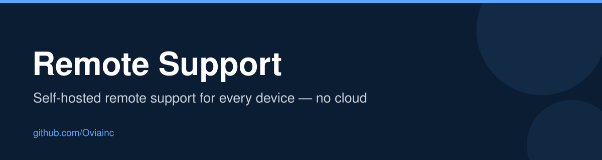

# Remote Support

Remote support that runs entirely on the owner's own infrastructure. Every
component — the host agent on each machine, the viewer, and the small server
that introduces the two ends — lives on hardware the owner controls. There is
no vendor cloud in the path: session traffic never transits a third party's
servers, and no account with any outside service is required to run it.

Built for in-house support teams, managed service providers, and any
organisation that wants remote help to stay inside its own walls.

## Platform matrix

| Platform | Role | Level |
| --- | --- | --- |
| Windows | Host + viewer | Full control |
| macOS | Host + viewer | Full control |
| Linux | Host + viewer | Full control |
| Android | Host + viewer | Full control |
| iPhone / iPad (iOS) | Host (limited) + viewer | View and guide on any device; full control only when the device is enrolled or bridge-paired (see below) |
| Web browser | Viewer / support console | Full control of desktop and Android hosts; covers Chromebooks and machines where nothing can be installed |

### iOS, stated plainly

iOS does not expose a general remote-control capability to third-party
software, and this product does not pretend otherwise. Support for an iPhone
works in tiers:

- **Any iPhone, instantly — view and guide.** The owner starts screen
  sharing with one tap. The supporter sees the screen, can point and
  annotate, and talks the owner through the fix.
- **Enrolled iPhone — full control.** Devices provisioned in advance through
  the managed automation route accept real taps, swipes and typing from the
  supporter. Enrolment is a one-time setup, done by whoever manages the
  fleet — never something asked of a person in the middle of a support call.
- **Bridge-paired iPhone — full control.** A small Bluetooth bridge device
  sitting near the phone presents itself as a standard keyboard and pointer;
  the screen arrives by mirroring. Works on an unmodified phone, within
  Bluetooth range of the bridge.

The session screen shows the tier in plain language — **View only** or
**Control available** — so nobody has to guess what a session can do.

## Design rules

- **Simple to deploy.** One installer or a single portable binary per
  platform. The rendezvous and relay server is one small self-hosted binary:
  drop it on any spare machine or small server and it runs — no database to
  provision, no cloud account, no licence server phoning home.
- **Outbound connections only.** Hosts and viewers connect out to the
  owner's server; no inbound ports, no port-forwarding, no firewall rules
  for the common case.
- **Simple pairing.** Each device shows a short code or a QR code once. The
  supporter enters it and the device joins the fleet register.
- **Fast first session.** Install to connected in under five minutes on a
  normal network. That figure is a testable requirement, not a slogan.
- **Clean, simple interface.** One session screen. Plain states, plain
  words. The complexity lives in the engineering, not in front of the user.
- **Secure by design.** End-to-end encrypted sessions, per-device identity
  keys, explicit consent before control, a visible indicator for the whole
  session, and a written audit log of every session. See `SECURITY.md`.

## Honest limits

This product does not promise "no problems". It names its failure modes and
handles each one:

- **Blocked direct connections.** When firewalls or NAT prevent a direct
  path, the owner's own relay carries the session instead. Slower route,
  same session — never a dead end.
- **Missing system permissions.** macOS and Android require one-time grants
  (screen recording, accessibility, background exemptions). The agent
  detects a missing grant and shows the owner the exact switch to flip,
  rather than failing silently.
- **Dropped connections.** Sessions reconnect and resume automatically; a
  network blip does not end a support call.
- **Weak networks.** The video encoder lowers quality before it drops
  frames, so control stays responsive on poor links.
- **iOS control.** Full control of an iPhone is available only in the
  enrolled and bridge-paired tiers described above. That boundary is
  Apple's, and it applies to every product in this category.

## Documents

- `SPEC.md` — the full requirement set
- `ARCHITECTURE.md` — how the system is put together
- `SECURITY.md` — threat model and non-negotiables
- `ROADMAP.md` — build phases and their done-definitions

## Status

Design stage. The specification and architecture are written; implementation
follows the phases in `ROADMAP.md`.

## Licence

Apache-2.0. See `LICENSE`.
